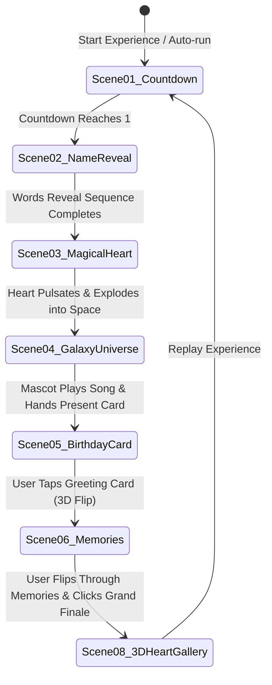

# PROJECT PLAN: Premium Interactive 3D Birthday Surprise Website

## 1. Project Overview & Scope
A hyper-polished, interactive 3D birthday surprise web application engineered as a high-conversion commercial demo for social media marketing (TikTok, Instagram Reels, YouTube Shorts). The application translates the magical, cinematic experience from the reference video into a responsive, modular, high-performance web experience.

---

## 2. Technical Stack & Dependencies

* **Core Runtime & Build:**
  * React 18 / 19 + TypeScript
  * Vite (superfast HMR, lightweight bundling)
* **3D & Canvas Rendering:**
  * Three.js
  * @react-three/fiber (declarative 3D scene graph)
  * @react-three/drei (camera controls, float, stars, textures, html annotations)
  * HTML5 Canvas 2D (custom high-performance Matrix rain canvas engine)
* **Animation & Transitions:**
  * Framer Motion (orchestration of layout, text reveals, spring physics, scene transitions)
  * Canvas particle loops with `requestAnimationFrame`
  * CSS 3D Transforms (hardware-accelerated greeting card opening and Polaroid flip)
* **UI & Styling:**
  * Tailwind CSS / Modular Modern CSS
  * Lucide React (clean, lightweight icons for sound, replay, navigation, gift, sparkles)
  * Google Fonts (*Dancing Script*, *Playfair Display*, *Poppins*, *Outfit*)
* **Audio Engine:**
  * Web Audio API / HTMLAudioElement with user-interaction unlock, fade-in/fade-out, play/pause, and fallback acoustic synthesizer / romantic melody.

---

## 3. System Architecture & Directory Structure

```text
Birthday/
├── public/
│   ├── assets/
│   │   ├── images/
│   │   │   ├── photo1.jpg
│   │   │   ├── photo2.jpg
│   │   │   ├── ... (8+ curated fictional aesthetic portraits)
│   │   │   ├── character.svg / cute-mascot.png
│   │   │   └── heart-icon.svg
│   │   └── audio/
│   │       └── romantic-melody.mp3
│   └── favicon.ico
├── src/
│   ├── components/
│   │   ├── AudioPlayer/
│   │   │   ├── AudioPlayer.tsx
│   │   │   └── RomanticSynth.ts (Zero-dependency Web Audio romantic piano fallback)
│   │   ├── BirthdayCard/
│   │   │   ├── InteractiveCard.tsx
│   │   │   └── CartoonHands.tsx
│   │   ├── GalaxyScene/
│   │   │   ├── CosmicCanvas.tsx
│   │   │   ├── Starfield.tsx
│   │   │   └── BirthdayMascot.tsx
│   │   ├── HeartAnimation/
│   │   │   └── BeatingHeart.tsx
│   │   ├── HeartPhotoGallery/
│   │   │   ├── HeartPhotoCanvas.tsx
│   │   │   ├── PhotoCard3D.tsx
│   │   │   └── heartMath.ts (Parametric 3D curve coordinates & animation curves)
│   │   ├── MatrixIntro/
│   │   │   ├── MatrixRainCanvas.tsx
│   │   │   └── CountdownOverlay.tsx
│   │   ├── PhotoGallery/
│   │   │   ├── DualPhotoViewer.tsx
│   │   │   └── MemoryCard.tsx
│   │   └── UI/
│   │       ├── CommercialModal.tsx
│   │       ├── FloatingControls.tsx
│   │       ├── NeonText.tsx
│   │       └── ParticleOverlay.tsx
│   ├── scenes/
│   │   ├── Scene01Countdown.tsx
│   │   ├── Scene02Reveal.tsx
│   │   ├── Scene03Heart.tsx
│   │   ├── Scene04Galaxy.tsx
│   │   ├── Scene05BirthdayCard.tsx
│   │   ├── Scene06PhotoMemories.tsx
│   │   └── Scene08HeartGallery.tsx
│   ├── config/
│   │   └── birthdayConfig.ts (Single source of truth for all personalizations)
│   ├── hooks/
│   │   ├── useAudio.ts
│   │   ├── useResponsive.ts
│   │   └── useWindowSize.ts
│   ├── styles/
│   │   └── index.css
│   ├── types/
│   │   └── index.ts
│   ├── App.tsx
│   └── main.tsx
├── DESIGN_ANALYSIS.md
├── PROJECT_PLAN.md
├── IMPLEMENTATION_ROADMAP.md
├── package.json
├── tailwind.config.js
├── tsconfig.json
└── vite.config.ts
```

---

## 4. Scene Progression & State Machine



* **Interactive Controls:**
  * Continuous automatic progress where appropriate with visual indicators.
  * Direct user-interaction moments (Tapping the card, flipping photos, interacting with the 3D heart).
  * Skip / Jump controls available for review and commercial demonstration.
  * Floating Audio Controller (Play / Pause / Volume).
  * Commercial Call-to-Action: "Custom Surprise Site? DM Me" banner/modal.

---

## 5. Configuration Architecture (`birthdayConfig.ts`)

Every customer-facing aspect is isolated in `birthdayConfig.ts`:
* **Recipient Name:** `"ANITA"`
* **Salutation & Nicknames:** `"Sayang"`, `"My Love"`, `"Bestie"`, etc.
* **Intro Messages & Countdown Timings**
* **Memory Slides:**
  * Array of pairs: `{ page: 1, message: "...", photos: [url1, url2] }`
* **Heart Collage Assets:**
  * Array of 16-24 photo URLs
* **Audio Track:**
  * File path or stream URL, volume, autoplay preferences
* **Theme Styling:**
  * Color codes (Neon Pink `#FF2E93`, Glow `#FF007F`, Accent `#FF69B4`)
  * Character Mascot details
* **Commercial Links:**
  * WhatsApp / Instagram DM / TikTok profile link for instant customer orders.

---

## 6. Performance & Responsive Strategy

1. **Mobile Optimization:**
   * Pixel ratio clamped to `Math.min(window.devicePixelRatio, 2)` to protect battery and GPU.
   * Dynamic particle density (matrix rain columns and star count scale down on mobile viewports).
   * 3D Heart camera distance dynamically calculated via vertical FOV so the heart is fully framed without horizontal overflow on mobile screens.
2. **Asset Optimization:**
   * High-quality fictional demo portraits stored locally as lightweight, properly compressed WebP/JPG assets.
   * Procedural Web Audio romantic fallback so the audio plays smoothly even if external audio files fail to load.
3. **Graceful Fallbacks:**
   * WebGL availability check: if Three.js encounters any context issue, an enhanced CSS 3D / canvas fallback gracefully renders the heart collage.

